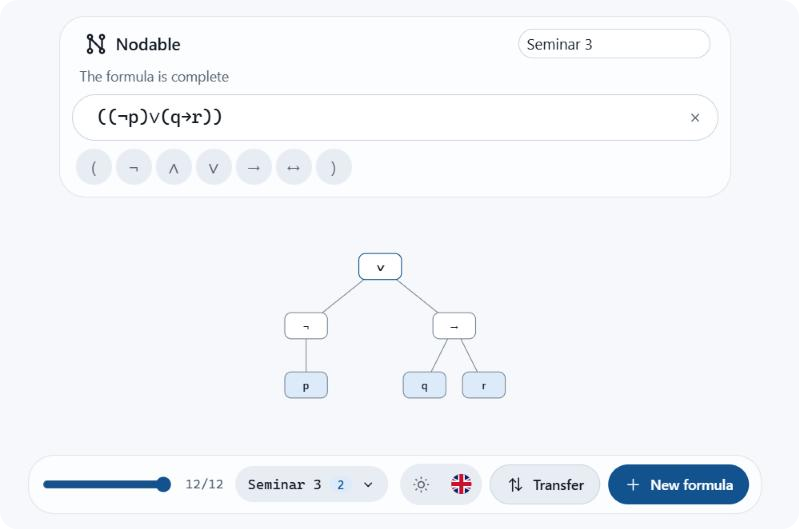

<p align="center">
  
</p>

# Nodable

Build syntax trees of propositional logic formulas in the browser, step by step, following the
conventions taught in the Computational Logic course.

[](https://github.com/[OWNER]/nodable/actions/workflows/ci.yml)
[](LICENSE)
[](https://github.com/[OWNER]/nodable/releases)



## Features

- Live tree construction: the tree is rebuilt on every keystroke.
- Course placement rules, with a cursor arrow showing where the next token applies.
- Dotted placeholder slots and an A/B indicator for groups whose arity is not yet decided.
- Clear diagnostics with stable codes and inline underlining of the offending range.
- Step replay: move through every intermediate state of the build.
- Drag and reposition nodes, with offsets kept per node.
- Workspaces with several formulas and a combined view.
- Export to SVG, PNG, JSON, LaTeX and plain text.
- Light, dark and system themes; English and Romanian.
- Fully client-side. No accounts, no server, no tracking.

## Quick Start

Prerequisites:

- Node.js, the version in [.nvmrc](.nvmrc)
- pnpm, enabled through Corepack

```bash
corepack enable
pnpm install
pnpm dev
```

The development server prints the local URL. To produce a production build:

```bash
pnpm build
```

## Usage

Type a formula into the input bar. The tree below updates on every keystroke, and the cursor arrow
marks the position where the next token will be placed.

Formulas are fully parenthesized: every binary connective and every negation is wrapped in its own
parentheses, for example `(p ∧ q)`, `(¬p)` and `((¬p) ∨ (p → q))`. A single variable such as `p` is
also a valid formula.

### Input aliases

| Connective  | Canonical | Aliases      |
| ----------- | --------- | ------------ |
| Negation    | `¬`       | `!`, `~`     |
| Conjunction | `∧`       | `&`, `/\`    |
| Disjunction | `∨`       | `\|`, `\/`   |
| Implication | `→`       | `->`, `=>`   |
| Equivalence | `↔`       | `<->`, `<=>` |

Aliases are replaced with canonical symbols as you type. Variables are a lowercase letter optionally
followed by digits, such as `p`, `q` or `r1`. Whitespace is ignored.

### Keyboard shortcuts

| Shortcut           | Action                           |
| ------------------ | -------------------------------- |
| `Enter`            | Add the formula to the workspace |
| `Escape`           | Clear the input bar              |
| `Arrow Left/Right` | Move through build steps         |
| `Tab`              | Move focus to the next control   |

## Notation

The tokenizer accepts the symbols above, the builder applies one placement rule per token, and the
validator reports diagnostics with codes `NDB001` through `NDB007`. See
[docs/notation.md](docs/notation.md) for the complete rules and worked examples.

## Architecture

```
apps/web        user interface (Svelte)
   |
   v
packages/sdk    public API: sessions, exports, workspaces
   |
   v
packages/engine pure logic core: tokenizer, builder, validator, tree model
```

Dependencies point downward only. The engine is pure and deterministic, the SDK is the only module
the interface imports from. See [docs/architecture.md](docs/architecture.md).

## Development

See [docs/development.md](docs/development.md) for scripts, testing and the release process.

## Contributing

Contributions are welcome. Please read [CONTRIBUTING.md](CONTRIBUTING.md) first.

## License

Released under the [MIT License](LICENSE).

## Acknowledgements

The tree-construction method, notation and placement rules follow the Computational Logic university
course.
