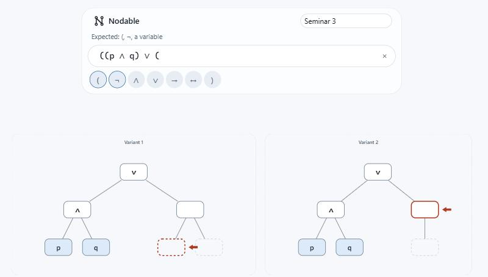
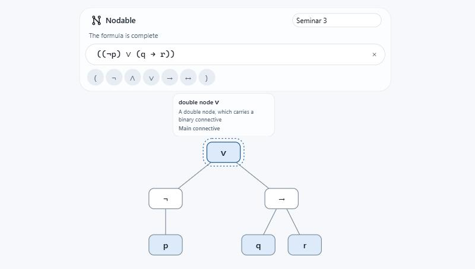
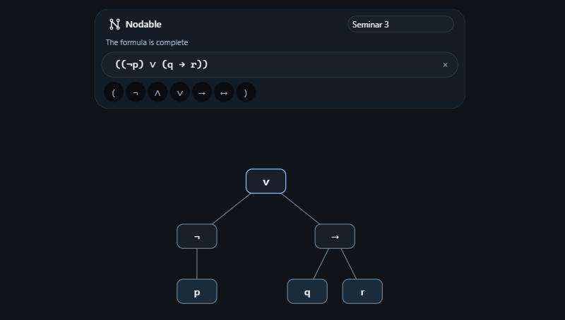

<p align="center">
  
</p>

<h1 align="center">Nodable</h1>

<p align="center">
  Build the syntax tree of a propositional logic formula, one token at a time.
</p>

<p align="center">
  <a href="https://github.com/[OWNER]/nodable/actions/workflows/ci.yml"></a>
  <a href="LICENSE"></a>
  <a href="https://github.com/[OWNER]/nodable/releases"></a>
</p>


Type a formula and the tree is rebuilt on every keystroke, following the placement rules taught in
the Computational Logic course. Everything runs in the browser: no account, no server, no tracking.

## Features

- **The method, not just the result.** An arrow marks where the next token goes, dotted boxes show
  what is still missing, and a slider replays the build step by step.
- **Both shapes while the arity is open.** Right after an open parenthesis a group can still become
  a single or a double node, so both are drawn side by side until the next token decides.
- **Clear errors.** The first mistake is reported in plain words and the last valid tree is kept.
- **Your work, kept and shared.** Several named formulas per workspace, saved locally, exported as
  SVG, PNG, LaTeX or plain text.
- **English and Romanian**, light and dark.

## The two shapes



While the arity of a group is undecided, Nodable draws both candidate trees. Everything already
built is shown in each of them, so the choice is the only difference.

## Reading a node



Click a node to see what it is. The main connective of the formula is named as such.

## Light and dark



## Quick start

Prerequisites: Node.js as pinned in [.nvmrc](.nvmrc), and pnpm through Corepack.

```bash
corepack enable
pnpm install
pnpm dev
```

`pnpm build` produces the static site in `apps/web/dist`.

## Writing formulas

Formulas are fully parenthesized: every connective and every negation is wrapped in its own
parentheses, as in `((¬p) ∨ q)`. A single variable such as `p` is a formula on its own.

| Connective  | Type | Or          |
| ----------- | ---- | ----------- |
| Negation    | `¬`  | `!` `~`     |
| Conjunction | `∧`  | `&` `/\`    |
| Disjunction | `∨`  | `\|` `\/`   |
| Implication | `→`  | `->` `=>`   |
| Equivalence | `↔`  | `<->` `<=>` |

Aliases become symbols as you type. A variable is a letter followed by digits, such as `p`, `q1` or
`P2`; names are case sensitive and spaces are ignored.

| Shortcut       | Action                    |
| -------------- | ------------------------- |
| `Enter`        | Start another formula     |
| `Escape`       | Clear the formula         |
| Wheel or pinch | Zoom                      |
| Drag           | Move around the workspace |

The full rules, with every diagnostic code, are in [docs/notation.md](docs/notation.md).

## Architecture

```
apps/web        interface (Svelte)
   ↓
packages/sdk    sessions, layout, exports
   ↓
packages/engine tokenizer, builder, validator
```

Dependencies point downward only. The engine is pure and deterministic, the SDK is the only module
the interface imports from. See [docs/architecture.md](docs/architecture.md).

## Contributing

Setup, scripts and the release process are in [docs/development.md](docs/development.md); the
conventions are in [CONTRIBUTING.md](CONTRIBUTING.md).

## License

[MIT](LICENSE).

## Acknowledgements

The notation and the construction method follow the Computational Logic university course.
