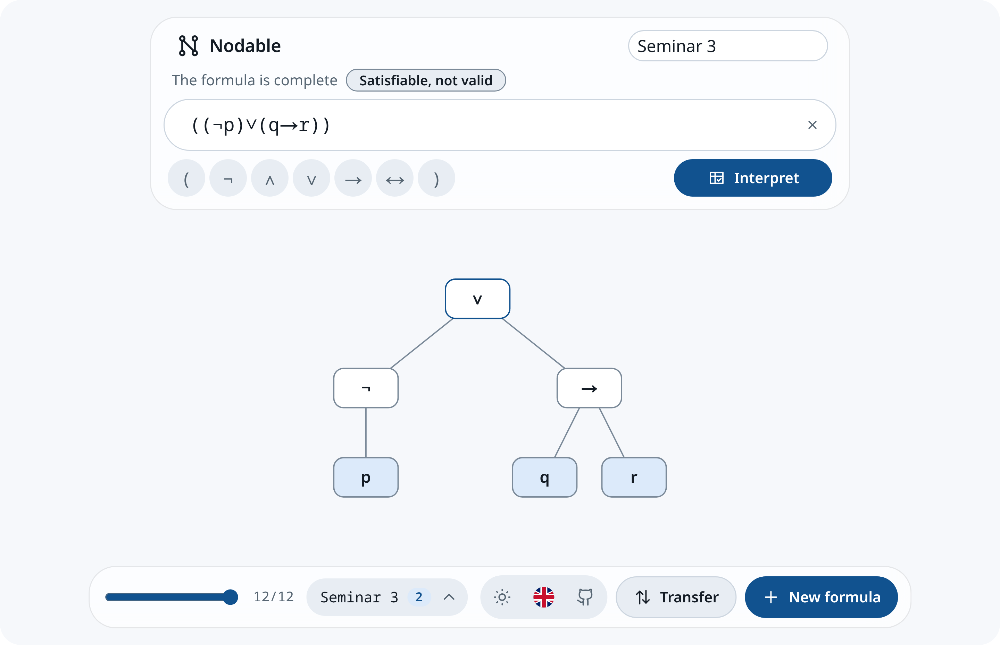
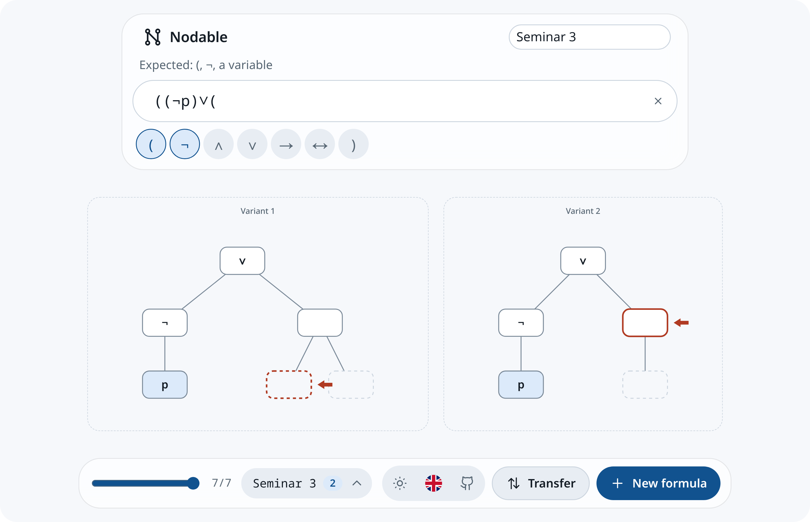
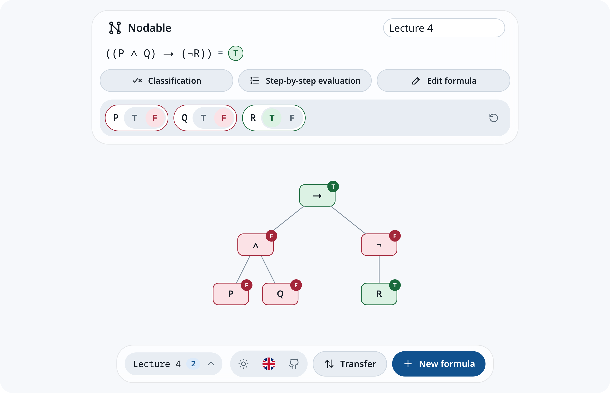
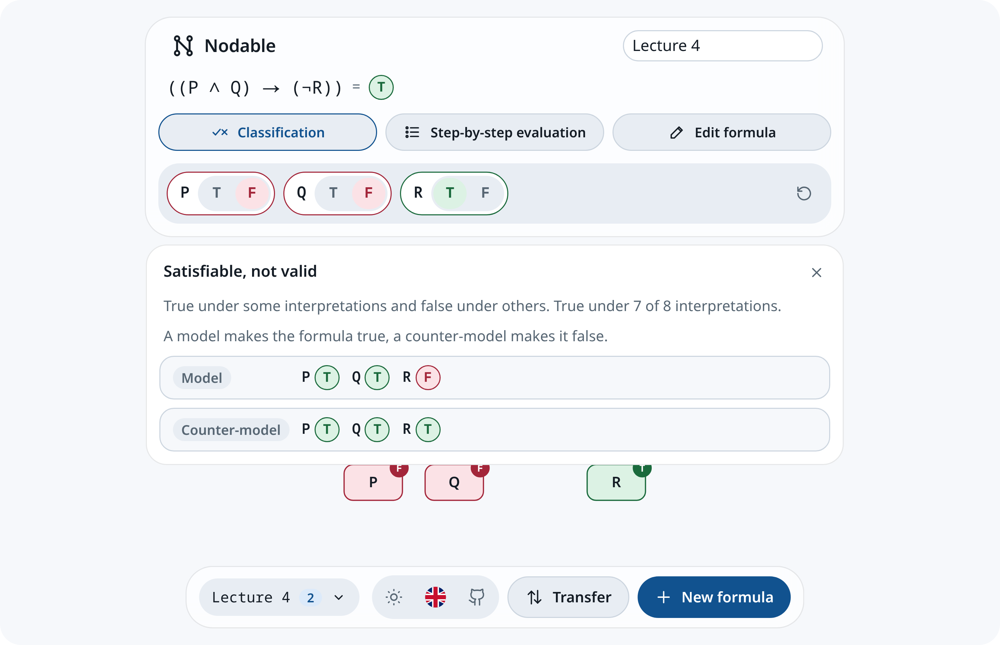
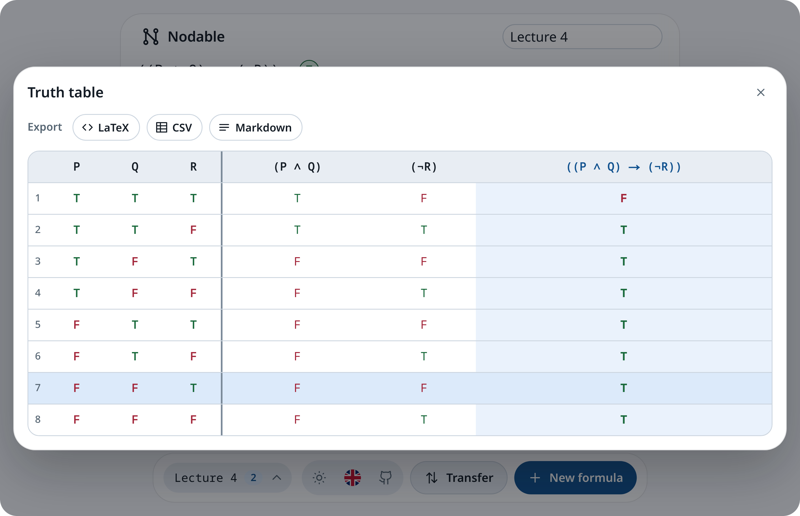
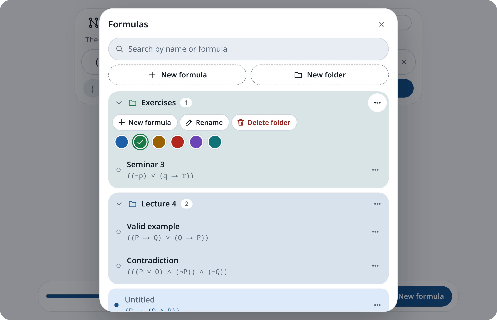
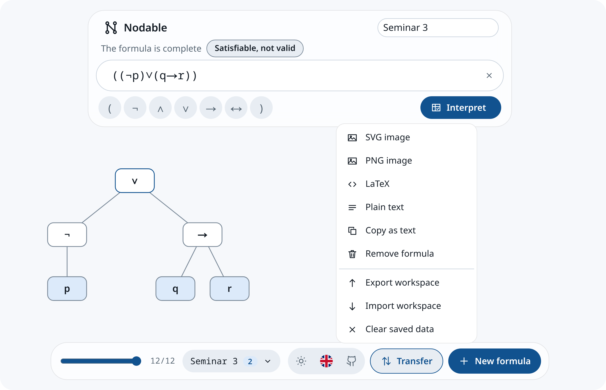
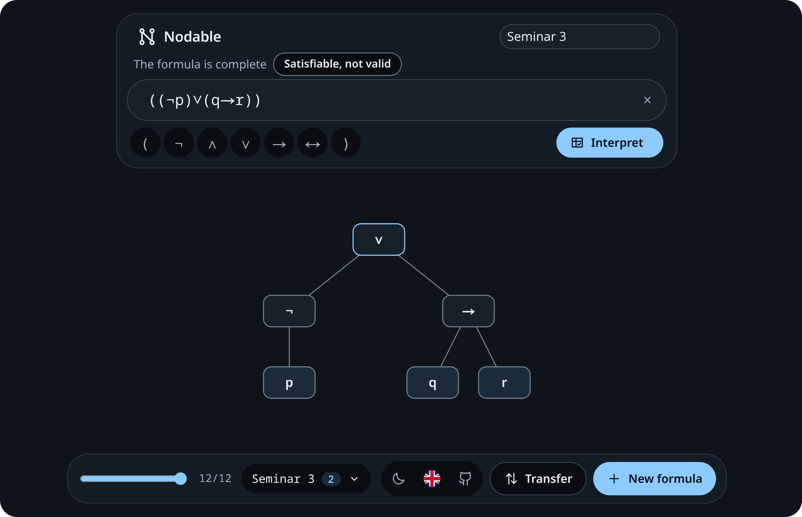

<p align="center" style="text-align: center">
  
</p>

<h1 align="center" style="text-align: center">Nodable</h1>

<p align="center" style="text-align: center">
  Syntax trees for propositional logic formulas, in the browser.
</p>

<p align="center" style="text-align: center">
  <a href="LICENSE"></a>
  <a href="https://svelte.dev"></a>
  <a href="https://www.typescriptlang.org"></a>
</p>



Type a formula and the tree is rebuilt on every keystroke, following the placement rules of the
Computational Logic course. Everything runs in the browser: no account, no server, no tracking.

Try it at [nodable-tree.vercel.app](https://nodable-tree.vercel.app).

## Features

- An arrow marks where the next token goes, and dotted boxes show what is still missing.
- Errors are reported in plain words, and the last valid tree is kept.
- A slider replays the construction from the first token to the last.
- A finished formula can be interpreted: give each variable a truth value and see the value of every
  node, step by step.
- A finished formula is classified as valid, satisfiable or unsatisfiable, with a model and a
  counter-model to try.
- A truth table lists every interpretation with the value of every subformula, and exports to
  LaTeX, CSV or Markdown.
- Several named formulas per workspace, searchable and sorted into folders, saved locally.
- Export to SVG, PNG, LaTeX, plain text or JSON.
- English and Romanian, light and dark.

## Undecided groups



After an open parenthesis, a group can still become a single or a double node. Nodable draws both
trees until the next token decides which one it is.

## Interpretation



Once the formula is complete, Interpret opens a separate view. Each variable is set to true or
false, and every node of the tree shows its value as soon as its children have one. Step-by-step
evaluation lists each subformula with the values it was computed from.

## Classification



A complete formula is checked under every interpretation and marked valid, satisfiable but not
valid, or unsatisfiable. In the interpretation view, Classification shows how many interpretations
make the formula true, with a model and a counter-model that load into the variables when clicked.

## Truth table



In the interpretation view, Table lists every interpretation, starting with every variable true. The variables come first, then each distinct subformula from the inside out, and the formula
itself last. The row of the current interpretation is highlighted, and clicking a row loads it into
the variables. The table exports to a LaTeX `tabular`, CSV or Markdown, from the table itself or
from Transfer, for formulas with up to 8 variables.

## Formulas and folders



The formula button in the dock opens the list of the workspace. It searches names and formulas,
and a search typed in ASCII such as `->` also finds `→`. Formulas are sorted into colored folders by
dragging them, with the mouse or after a short press on a touch screen, or through the Move action.
Each formula can also be renamed, duplicated and deleted. Deleting a folder deletes its formulas
too, so it asks for a second tap first.

## Exports



Transfer opens the export options for the active formula, its truth table and the workspace. An image export
reproduces what is on screen, both variants included, with the formula at the top, and the file is
named after the formula. Each option shows a spinner while the file is prepared and a check once it
is saved. JSON holds the whole workspace, folders included, and can be imported back.

## Dark theme



## Quick start

Node.js as pinned in [.nvmrc](.nvmrc), and pnpm through Corepack.

```bash
corepack enable
pnpm install
pnpm dev
```

`pnpm build` writes the static site to `apps/web/dist`.

## Writing formulas

Formulas are fully parenthesized: every connective and every negation has its own parentheses, as
in `((¬p) ∨ q)`. A single variable such as `p` is also a formula.

| Connective  | Symbol | Also accepted |
| ----------- | ------ | ------------- |
| Negation    | `¬`    | `!` `~`       |
| Conjunction | `∧`    | `&` `/\`      |
| Disjunction | `∨`    | `\|` `\/`     |
| Implication | `→`    | `->` `=>`     |
| Equivalence | `↔`    | `<->` `<=>`   |

The complete rules and the diagnostic codes are in [docs/notation.md](docs/notation.md).

## Architecture

```
apps/web        interface (Svelte)
   ↓
packages/sdk    sessions, workspaces, layout, exports
   ↓
packages/engine tokenizer, builder, validator, semantics
```

Dependencies point downward only. The engine is pure and deterministic; the interface imports from
the SDK and nothing else. See [docs/architecture.md](docs/architecture.md).

## Contributing

Scripts, tests and the release process are in [docs/development.md](docs/development.md). The
conventions are in [CONTRIBUTING.md](CONTRIBUTING.md).

## License

[MIT](LICENSE).

## Acknowledgements

The notation and the construction method follow the Computational Logic university course.
