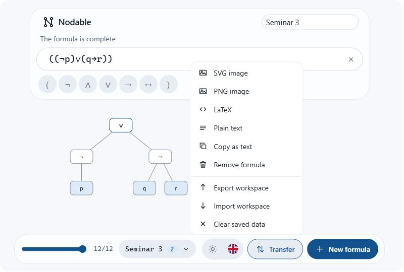

<p align="center" style="text-align: center">
  
</p>

<h1 align="center" style="text-align: center">Nodable</h1>

<p align="center" style="text-align: center">
  Syntax trees for propositional logic formulas, in the browser.
</p>

<p align="center" style="text-align: center">
  <a href="LICENSE"></a>
  <a href="https://svelte.dev"></a>
  <a href="https://www.typescriptlang.org"></a>
</p>


Type a formula and the tree is rebuilt on every keystroke, following the placement rules of the
Computational Logic course. Everything runs in the browser: no account, no server, no tracking.

## Features

- An arrow marks where the next token goes, and dotted boxes show what is still missing.
- Errors are reported in plain words, and the last valid tree is kept.
- A slider replays the construction from the first token to the last.
- Several named formulas per workspace, saved locally.
- Export to SVG, PNG, LaTeX, plain text or JSON.
- English and Romanian, light and dark.

## Undecided groups


After an open parenthesis, a group can still become a single or a double node. Nodable draws both
trees until the next token decides which one it is.

## Exports



An image export reproduces what is on screen, both variants included, with the formula at the top,
and the file is named after the formula. JSON holds the whole workspace and can be imported back.

## Dark theme


## Quick start

Node.js as pinned in [.nvmrc](.nvmrc), and pnpm through Corepack.

```bash
corepack enable
pnpm install
pnpm dev
```

`pnpm build` writes the static site to `apps/web/dist`.

## Writing formulas

Formulas are fully parenthesized: every connective and every negation has its own parentheses, as
in `((¬p) ∨ q)`. A single variable such as `p` is also a formula.

| Connective  | Symbol | Also accepted |
| ----------- | ------ | ------------- |
| Negation    | `¬`    | `!` `~`       |
| Conjunction | `∧`    | `&` `/\`      |
| Disjunction | `∨`    | `\|` `\/`     |
| Implication | `→`    | `->` `=>`     |
| Equivalence | `↔`    | `<->` `<=>`   |

The complete rules and the diagnostic codes are in [docs/notation.md](docs/notation.md).

## Architecture

```
apps/web        interface (Svelte)
   ↓
packages/sdk    sessions, layout, exports
   ↓
packages/engine tokenizer, builder, validator
```

Dependencies point downward only. The engine is pure and deterministic; the interface imports from
the SDK and nothing else. See [docs/architecture.md](docs/architecture.md).

## Contributing

Scripts, tests and the release process are in [docs/development.md](docs/development.md). The
conventions are in [CONTRIBUTING.md](CONTRIBUTING.md).

## License

[MIT](LICENSE).

## Acknowledgements

The notation and the construction method follow the Computational Logic university course.
