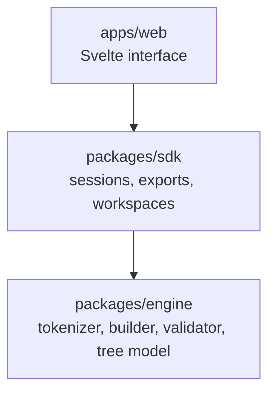
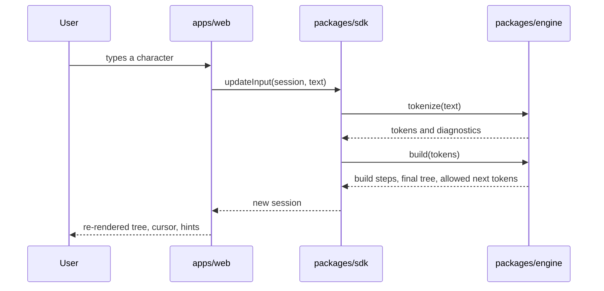

# Architecture

Nodable has three layers. Dependencies point downward only.

The interface never imports the engine directly, and the engine never reaches upward. Each package
exposes its public API only through `src/index.ts`; deep imports across packages are not allowed.

## packages/engine

The engine holds the course rules and nothing else.

- Pure TypeScript. No DOM, no Svelte, no browser APIs, no storage.
- Every public function is pure and deterministic: the same input always produces the same output.
- Data is immutable. Functions return new objects and never mutate their arguments.

| Area         | Responsibility                                                                   |
| ------------ | -------------------------------------------------------------------------------- |
| `tokenizer/` | Turn raw input text into tokens and normalize ASCII aliases to canonical symbols |
| `builder/`   | Apply the placement rules one token at a time and record every intermediate step |
| `validator/` | Produce diagnostics and the set of tokens allowed next                           |
| `model/`     | Types and helpers for nodes, slots and cursor position                           |

## packages/sdk

The SDK is the only module the interface imports from. It wraps the engine in a small, stable API
and owns the concepts the interface works with.

- **Sessions**: one formula, its build steps, its diagnostics and its per-node layout offsets.
- **Exporters**: SVG, PNG, JSON, LaTeX and plain text.
- **Workspaces**: several sessions, serialized and deserialized as JSON.

The SDK is storage-agnostic. Persistence goes through an adapter interface that the web app
implements, so the SDK never touches IndexedDB or `localStorage` itself.

See [sdk-reference.md](sdk-reference.md) for the full public surface.

## apps/web

The web app is a thin presentation layer.

- It contains no logic rules. Every decision about the tree comes from the SDK.
- Components are small and single-purpose.
- State lives in Svelte runes-based stores under `src/lib/state`.
- It implements the storage adapter, themes, internationalization and all interaction such as
  dragging, highlighting and animation.

## Data flow

## Design decisions

### Rebuild on every change

On each input change the whole tree is rebuilt from the input string. There is no incremental
patching. Formulas are short, so a rebuild is instant, deletion becomes trivial, and step replay
comes for free.

### The build is a list of steps

The builder returns an ordered array of `BuildStep` snapshots. The interface renders the last one; a
step slider can render any earlier one.

### Stable node identifiers

A node's identifier is derived from its path in the tree: `root`, `root.0`, `root.1.0`. Because the
identifier does not depend on build order, animations and drag offsets survive a rebuild.

### Result types instead of exceptions

Engine and SDK functions never throw for invalid user input; they return diagnostics. Exceptions are
reserved for programmer errors.

### Immutability

Engine and SDK types are `readonly` throughout. A function that changes a session returns a new
session, which keeps comparisons cheap and makes Svelte reactivity predictable.
