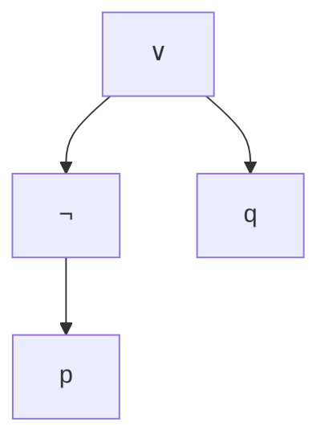

# Notation

This document is the reference for how Nodable reads a formula and builds its tree. It follows the
conventions of the Computational Logic course.

## Symbols

| Kind              | Canonical                                                            | Accepted input aliases |
| ----------------- | -------------------------------------------------------------------- | ---------------------- |
| Negation          | `¬`                                                                  | `!`, `~`               |
| Conjunction       | `∧`                                                                  | `&`, `/\`              |
| Disjunction       | `∨`                                                                  | `\|`, `\/`             |
| Implication       | `→`                                                                  | `->`, `=>`             |
| Equivalence       | `↔`                                                                  | `<->`, `<=>`           |
| Open parenthesis  | `(`                                                                  |                        |
| Close parenthesis | `)`                                                                  |                        |
| Variable          | a letter optionally followed by digits, such as `p`, `q`, `r1`, `P2` |                        |

Whitespace is ignored, variable names are case sensitive, and the input bar replaces aliases with
canonical symbols as you type.

Formulas are **fully parenthesized**: every binary connective and every negation is wrapped in its
own parentheses. `(p ∧ q)`, `(¬p)` and `((¬p) ∨ (p → q))` are well formed. A single bare variable
such as `p` is also a well-formed formula. Formulas that rely on operator precedence, such as
`¬p ∨ q`, are rejected.

## Node states

| State    | Meaning                                                  | Visual                                                          |
| -------- | -------------------------------------------------------- | --------------------------------------------------------------- |
| `slot`   | An empty position that must still be filled              | Dotted, empty box                                               |
| `group`  | Opened by `(`, arity not yet known                       | Dashed box; the two possible outcomes are shown beside the tree |
| `unary`  | A resolved single node, labeled `¬`                      | Solid box with one child                                        |
| `binary` | A resolved double node, labeled with a binary connective | Solid box with two children                                     |
| `leaf`   | A variable                                               | Solid box, leaf style                                           |

## Cursor

The cursor, drawn as an arrow to the right of a node, points at the node where the next token
applies. It starts on the `root` slot. When it moves above the root the formula is complete, and
the interface stops drawing the arrow and marks the root instead.

## Placement rules

| Token     | Precondition                                                         | Effect                                                                                                                            | Cursor                             |
| --------- | -------------------------------------------------------------------- | --------------------------------------------------------------------------------------------------------------------------------- | ---------------------------------- |
| `(`       | Cursor on a `slot`                                                   | The slot becomes a `group` with its arity undecided, and a first child `slot` is created                                          | Moves **down** to the first child  |
| variable  | Cursor on a `slot`                                                   | The slot becomes a `leaf`. If the parent is a `group` with no label yet, the parent stays pending until the next token decides it | Moves **up** one level             |
| `¬`       | Cursor on the first child `slot` of a `group`, directly after `(`    | The parent `group` resolves to `unary` and is labeled `¬`. The symbol is placed one level **up**                                  | Stays on the single child slot     |
| `∧ ∨ → ↔` | Cursor on a `group` whose first child is complete                    | The group resolves to `binary` and is labeled with the connective, and a second child `slot` is created                           | Moves **down** to the second child |
| `)`       | Cursor on a `unary` or `binary` node whose children are all complete | The node is closed                                                                                                                | Moves **up** one level             |

In the words used in class:

- A variable or `)` moves **up**.
- A group cannot be closed before it has become a single or a double node, so `(p)` is rejected.
- `(` moves **down** and opens the choice between a double and a single node.
- A variable after `(` produces a **double node**; a negation after `(` produces a **single node**.
- A negation is placed **up**, on the parent.
- A connective moves **down**.

## Worked example

Input: `((¬p) ∨ q)`

| Step | Token | Tree change                          | Cursor               |
| ---- | ----- | ------------------------------------ | -------------------- |
| 0    |       | `root` = slot                        | `root`               |
| 1    | `(`   | `root` = group, `root.0` = slot      | `root.0`             |
| 2    | `(`   | `root.0` = group, `root.0.0` = slot  | `root.0.0`           |
| 3    | `¬`   | `root.0` = unary `¬`                 | `root.0.0`           |
| 4    | `p`   | `root.0.0` = leaf `p`                | `root.0`             |
| 5    | `)`   | `root.0` closed                      | `root`               |
| 6    | `∨`   | `root` = binary `∨`, `root.1` = slot | `root.1`             |
| 7    | `q`   | `root.1` = leaf `q`                  | `root`               |
| 8    | `)`   | `root` closed                        | above root, complete |

The finished tree:

## Node identifiers

A node's identifier is its path from the root: `root`, then `root.0` for a first child, `root.1` for
a second child, `root.1.0` for the first child of that, and so on. Identifiers do not depend on the
order in which nodes were created, so they stay stable when the tree is rebuilt after a keystroke.

## Diagnostics

Every diagnostic carries a stable code, a severity, a range of character offsets into the input, and
a translation key. Messages are never hard-coded in the engine.

| Code     | Severity | Condition                                                 |
| -------- | -------- | --------------------------------------------------------- |
| `NDB001` | error    | Unknown character                                         |
| `NDB002` | error    | Token not allowed at the current cursor position          |
| `NDB003` | error    | Unmatched `)`                                             |
| `NDB004` | error    | Input continues after the formula is complete             |
| `NDB005` | error    | `¬` not directly after `(`                                |
| `NDB006` | error    | Connective missing a left operand                         |
| `NDB007` | warning  | Formula incomplete: an unclosed `(` or empty slots remain |

### Workspace diagnostics

One further code is reported by the SDK rather than by the formula rules, because reading a stored
workspace can fail in a way that has nothing to do with a formula.

| Code     | Severity | Condition                        |
| -------- | -------- | -------------------------------- |
| `NDB008` | error    | Workspace data could not be read |

### Behavior

An incomplete formula while typing is normal: it is shown with dotted slots and a warning, never as
an error. On the first error the builder stops applying tokens, keeps the last valid tree, and marks
the offending range in the input.

## Interpretation

Once a formula is complete it can be interpreted: every variable receives a truth value, true or
false, and the value of the formula is computed from its tree, from the leaves up to the root.

| Node      | Value                                         |
| --------- | --------------------------------------------- |
| variable  | the value given to it                         |
| `(¬φ)`    | true when `φ` is false                        |
| `(φ ∧ ψ)` | true when both `φ` and `ψ` are true           |
| `(φ ∨ ψ)` | true when at least one of `φ` and `ψ` is true |
| `(φ → ψ)` | false only when `φ` is true and `ψ` is false  |
| `(φ ↔ ψ)` | true when `φ` and `ψ` have the same value     |

Every occurrence of a variable takes the same value. A node gets a value only once the values of all
its children are known, so while some variables are still open the interface shows which parts of
the tree are already decided. The interface writes the values as `T` and `F` in English and as `A`
and `F` in Romanian.

## Classification

A complete formula is also checked under every interpretation of its variables, the way a truth
table lists them, starting with every variable true.

| Label in the interface   | Meaning                                                        |
| ------------------------ | -------------------------------------------------------------- |
| Satisfiable, valid       | True under every interpretation (a tautology)                  |
| Satisfiable, not valid   | True under at least one interpretation and false under another |
| Unsatisfiable, not valid | False under every interpretation (a contradiction)             |

Every valid formula is satisfiable and every unsatisfiable formula is not valid, so the label names
both properties.

The interface shows the class next to the hint once the formula is complete. In the interpretation
view a Classification button opens a modal with the class, how many interpretations make the
formula true, the first model and the first counter-model in truth-table order; clicking one loads
it into the variables. The step-by-step evaluation opens the same way, so neither makes the panel
taller. On narrow screens the modal is a sheet that rises from the bottom and closes when dragged
down.
Formulas with more than 16 variables are not classified.

## Truth table

The truth table has one row per interpretation, in the same order as the classification, starting
with every variable true. Its columns are the variables, in the order they first appear, then each
distinct subformula in the order it is computed, from the inside out, with the whole formula last.
A subformula that appears more than once, such as `(¬p)` in `((¬p) ∧ (¬p))`, has a single column.
Values are written with the letters of the interface: T and F in English, A and F in Romanian.

The table opens from the interpretation view. The row that matches the current interpretation is
highlighted, and clicking a row loads it into the variables. It can be saved as a LaTeX `tabular`,
a CSV file or a Markdown table. Formulas with more than 8 variables have no table, since it would
hold more than 256 rows.

## Hints

After every step the engine computes the set of tokens allowed next. The interface uses it to
highlight the valid toolbar buttons and to show a short hint such as
`Expected: variable, ¬, or (`.
