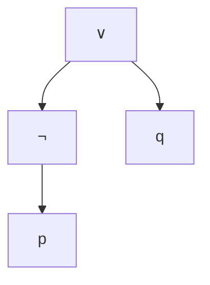

# Notation

This document is the reference for how Nodable reads a formula and builds its tree. It follows the
conventions of the Computational Logic course.

## Symbols

| Kind              | Canonical                                                                | Accepted input aliases |
| ----------------- | ------------------------------------------------------------------------ | ---------------------- |
| Negation          | `¬`                                                                      | `!`, `~`               |
| Conjunction       | `∧`                                                                      | `&`, `/\`              |
| Disjunction       | `∨`                                                                      | `\|`, `\/`             |
| Implication       | `→`                                                                      | `->`, `=>`             |
| Equivalence       | `↔`                                                                      | `<->`, `<=>`           |
| Open parenthesis  | `(`                                                                      |                        |
| Close parenthesis | `)`                                                                      |                        |
| Variable          | a lowercase letter optionally followed by digits, such as `p`, `q`, `r1` |                        |

Whitespace is ignored. The input bar replaces aliases with canonical symbols as you type.

Formulas are **fully parenthesized**: every binary connective and every negation is wrapped in its
own parentheses. `(p ∧ q)`, `(¬p)` and `((¬p) ∨ (p → q))` are well formed. A single bare variable
such as `p` is also a well-formed formula. Formulas that rely on operator precedence, such as
`¬p ∨ q`, are rejected.

## Node states

| State    | Meaning                                                  | Visual                                                    |
| -------- | -------------------------------------------------------- | --------------------------------------------------------- |
| `slot`   | An empty position that must still be filled              | Dotted, empty box                                         |
| `group`  | Opened by `(`, arity not yet known                       | Box showing two options, **A** (binary) and **B** (unary) |
| `unary`  | A resolved single node, labeled `¬`                      | Solid box with one child                                  |
| `binary` | A resolved double node, labeled with a binary connective | Solid box with two children                               |
| `leaf`   | A variable                                               | Solid box, leaf style                                     |

## Cursor

The cursor, drawn as an arrow, points at the node where the next token applies. It starts on the
`root` slot. When it moves above the root, the formula is complete.

## Placement rules

| Token     | Precondition                                                                  | Effect                                                                                                                            | Cursor                             |
| --------- | ----------------------------------------------------------------------------- | --------------------------------------------------------------------------------------------------------------------------------- | ---------------------------------- |
| `(`       | Cursor on a `slot`                                                            | The slot becomes a `group` with the A/B choice pending, and a first child `slot` is created                                       | Moves **down** to the first child  |
| variable  | Cursor on a `slot`                                                            | The slot becomes a `leaf`. If the parent is a `group` with no label yet, the parent stays pending until the next token decides it | Moves **up** one level             |
| `¬`       | Cursor on the first child `slot` of a `group`, directly after `(`             | The parent `group` resolves to `unary` and is labeled `¬`. The symbol is placed one level **up**                                  | Stays on the single child slot     |
| `∧ ∨ → ↔` | Cursor on a `group` whose first child is complete                             | The group resolves to `binary` and is labeled with the connective, and a second child `slot` is created                           | Moves **down** to the second child |
| `)`       | Cursor on a `group`, `unary` or `binary` node whose children are all complete | The node is closed                                                                                                                | Moves **up** one level             |

In the words used in class:

- A variable or `)` moves **up**.
- `(` moves **down** and shows the A/B choice.
- A variable after `(` produces a **double node**; a negation after `(` produces a **single node**.
- A negation is placed **up**, on the parent.
- A connective moves **down**.

## Worked example

Input: `((¬p) ∨ q)`

| Step | Token | Tree change                          | Cursor               |
| ---- | ----- | ------------------------------------ | -------------------- |
| 0    |       | `root` = slot                        | `root`               |
| 1    | `(`   | `root` = group, `root.0` = slot      | `root.0`             |
| 2    | `(`   | `root.0` = group, `root.0.0` = slot  | `root.0.0`           |
| 3    | `¬`   | `root.0` = unary `¬`                 | `root.0.0`           |
| 4    | `p`   | `root.0.0` = leaf `p`                | `root.0`             |
| 5    | `)`   | `root.0` closed                      | `root`               |
| 6    | `∨`   | `root` = binary `∨`, `root.1` = slot | `root.1`             |
| 7    | `q`   | `root.1` = leaf `q`                  | `root`               |
| 8    | `)`   | `root` closed                        | above root, complete |

The finished tree:

## Node identifiers

A node's identifier is its path from the root: `root`, then `root.0` for a first child, `root.1` for
a second child, `root.1.0` for the first child of that, and so on. Identifiers do not depend on the
order in which nodes were created, so they stay stable when the tree is rebuilt after a keystroke.

## Diagnostics

Every diagnostic carries a stable code, a severity, a range of character offsets into the input, and
a translation key. Messages are never hard-coded in the engine.

| Code     | Severity | Condition                                                 |
| -------- | -------- | --------------------------------------------------------- |
| `NDB001` | error    | Unknown character                                         |
| `NDB002` | error    | Token not allowed at the current cursor position          |
| `NDB003` | error    | Unmatched `)`                                             |
| `NDB004` | error    | Input continues after the formula is complete             |
| `NDB005` | error    | `¬` not directly after `(`                                |
| `NDB006` | error    | Connective missing a left operand                         |
| `NDB007` | warning  | Formula incomplete: an unclosed `(` or empty slots remain |

### Workspace diagnostics

One further code is reported by the SDK rather than by the formula rules, because reading a stored
workspace can fail in a way that has nothing to do with a formula.

| Code     | Severity | Condition                        |
| -------- | -------- | -------------------------------- |
| `NDB008` | error    | Workspace data could not be read |

### Behavior

An incomplete formula while typing is normal: it is shown with dotted slots and a warning, never as
an error. On the first error the builder stops applying tokens, keeps the last valid tree, and marks
the offending range in the input.

## Hints

After every step the engine computes the set of tokens allowed next. The interface uses it to
highlight the valid toolbar buttons and to show a short hint such as
`Expected: variable, ¬, or (`.
